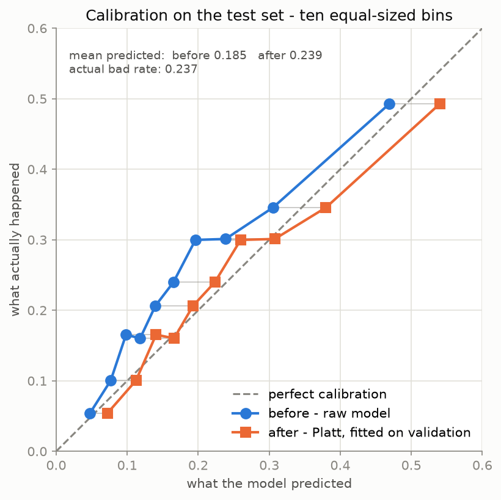
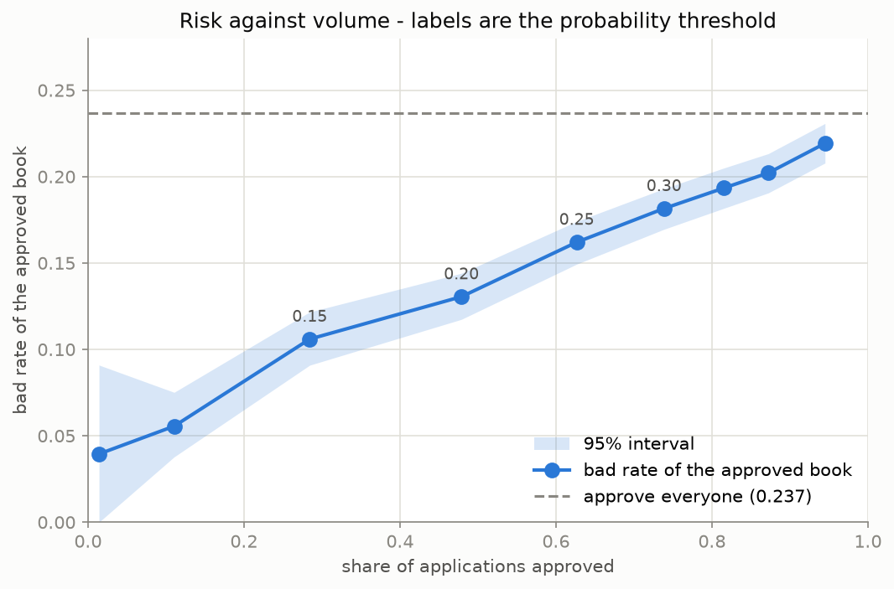
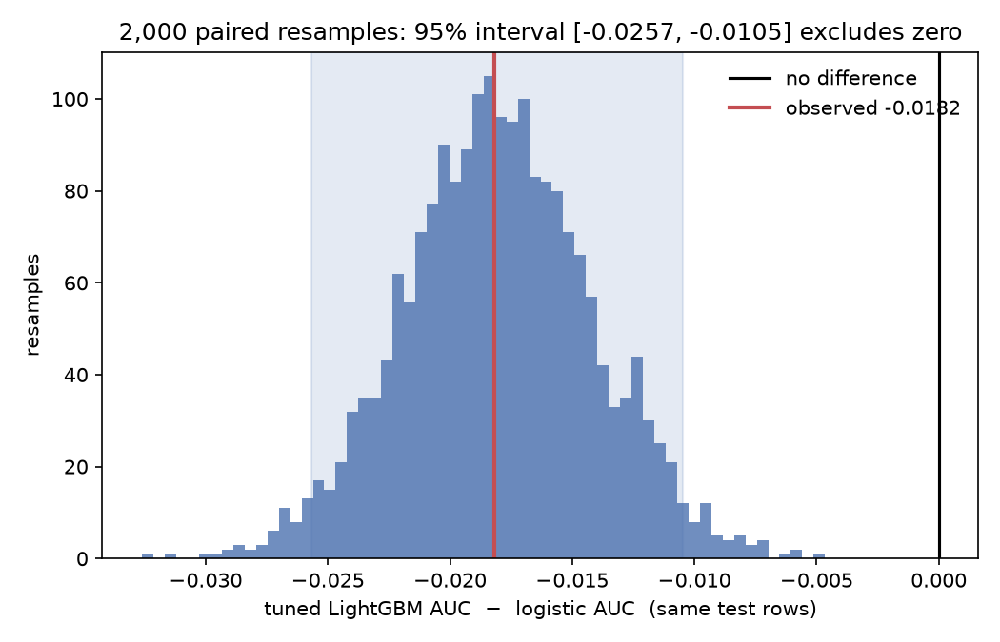
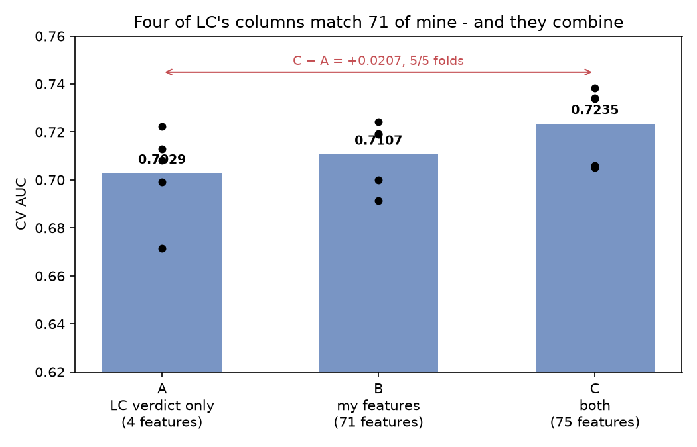

# Credit Risk Engine

Predicting the probability that a Lending Club borrower defaults, and turning
that probability into an approve/reject decision.

Built in ten slices, each finished and written up before the next starts. The
point of the project is not a high score — it is a model whose numbers can be
trusted, with every decision and every failure documented.

**Slices 1–7 are complete.** The model below is a logistic regression. Slice 6
tried to beat it with gradient boosting, did the work properly, and failed —
which is why it is still here. Slice 7 then found that the model it beat is
measurably fairer than it is.

---

## Where it stands

| | |
|---|---|
| Test AUC | **0.6908**, 95% interval [0.6739, 0.7067] |
| Average precision | **0.3918** against a no-skill floor of 0.2365 — a 1.66× lift |
| Probabilities | corrected from **5.1 points low** to **0.3 points high** |
| At a 20% threshold | approve 47.9% of applications, bad rate **13.05%** [11.7%, 14.4%] vs 23.65% for approving everyone |

Measured on 5,378 loans issued 2016-09 to 2017-12, by a model trained only on
loans issued before 2016-01. `grade`, `sub_grade`, `int_rate` and `installment`
are deliberately held out — the model never sees Lending Club's own verdict on
the borrower.

### Calibration

A model can rank well and still output numbers that are false as probabilities.
This one under-stated risk by about 5 points everywhere. A sigmoid correction,
fitted on a validation split the model never trained on, fixes it:



Each pair of points is the same group of borrowers. The correction never
reorders anyone — it only moves the label. Every one of the ten bins sat above
the diagonal before; afterwards they scatter around it.

### Risk against volume



The trade is close to linear: every extra 10 points of approvals costs roughly
2 points of bad rate, the whole way across. There is no kink, so no operating
point can be read off the data — it can only come from what a default costs
against what a lost customer earns. That is slice 8.

---

## Does a stronger model help? No.

Gradient boosting usually wins on tabular data. Here it did not, and slice 6 is
the record of finding that out properly rather than assuming it either way.

LightGBM at its defaults lost on all five cross-validation folds. It was then
tuned across **44 configurations under a search declared in writing and
committed to git before it ran** — the grid, the stopping rule, what counts as
a win, and what happens if it loses. When the winner landed on a grid edge, the
one extension the declaration permitted was declared and run. It came back
worse, confirming the edge was a real optimum and not a wall.

| | CV AUC | in-sample | gap |
|---|---|---|---|
| LightGBM, defaults | 0.6830 | 0.9304 | 0.2474 |
| LightGBM, tuned | 0.7053 | 0.7249 | 0.0196 |
| **logistic (ships)** | **0.7107** | — | — |

Tuning worked — the overfitting gap fell by a factor of twelve, leaving the
boosted model generalising as cleanly as the linear one. It still lost.



On the test set, scored on identical rows and compared with a paired bootstrap:
**−0.0182 AUC, 95% interval [−0.0257, −0.0105]**. The interval excludes zero, so
the loss survives sampling luck. Average precision, Brier and log loss are all
indistinguishable between the two models. Worse at ranking, no better anywhere.

Two things fall out of the attempt that are worth more than the result:

**The boosted model cannot blow up.** The logistic model scores one test loan at
probability 1.000000 — a borrower whose stated income makes the loan 19.5× their
annual earnings, eleven times past anything in training, and the loan was repaid.
That single row is 1.2% of the model's entire test log loss. A tree cannot make
that mistake: above its highest split there is nothing left to say, so the same
borrower scores 0.25 instead of 1.00. Demonstrated on a synthetic row, so no
held-out data was spent proving it.

**Regularisation and a linear model converge.** Tuned down to four leaves, the
boosted model lands within 0.005 of logistic regression, with a near-identical
generalisation gap. A one-split-per-tree stump — no interactions representable
at all — reaches 0.7010. Three very different levels of flexibility, one answer.
The usable signal in this data is close to additive, and slice 3 already
explained why.

---

## Four columns of Lending Club's verdict match seventy-one of mine

`grade`, `sub_grade`, `int_rate` and `installment` were held out from slice 3
onward, for one comparison at the end of slice 6.



| | features | CV AUC |
|---|---|---|
| Lending Club's verdict alone | 4 | 0.7029 |
| This project's feature set | 71 | 0.7107 |
| Both together | 75 | **0.7235** |

Alone, the two are a statistical tie — professional underwriters compressed the
same predictive power into a single letter. But they are **not redundant**:
together they beat either one, each on five folds out of five.

That gap is a measurement of something slice 3 could only argue. Lending Club
assigned `grade` while looking at the **whole applicant pool, including everyone
they rejected**. This dataset contains only the people who got through, which is
why FICO scores just 1.8× here and the entire delinquency family is flat. The
+0.0128 that `grade` adds on top of 71 engineered features is a lower bound on
how much predictive information was destroyed before the data was written.

**And the shipped model still cannot use it.** Not because it is leakage — all
four columns are known before funding — but because of *when*. An investor
picking among already-listed loans can see the grade. A lender deciding whether
to approve cannot: assigning the grade **is** the decision. This project is the
lender's seat, so the most accurate model built in slice 6 is one that may not
be used.

---

## What this project is actually about

Most of the work is in not fooling yourself.

**Leakage.** The raw data has 151 columns, many of which only exist *after* a
loan goes bad — recoveries, total principal received, last payment date. Finding
and removing them is a slice of its own.

**Time, never random.** Every split is by issue date. The test set is a later
period, not a random sample, so the model is always judged on predicting
forward.

**Nothing learned from held-out data.** Medians, rare-level lists, scaling
factors, the regularisation strength, the calibration mapping — each is fitted
on training data only and applied unchanged.

**Decisions declared before the results exist.** Slice 6's tuning search was
written down and committed to git before it ran, including what would count as a
win and what would happen if nothing did. In a finished notebook, "the model
lost" and "I stopped looking when I was ahead" are indistinguishable. A
timestamp is the only thing that separates them.

**Intervals, not point estimates.** 5,378 test rows is not many. Bootstrap
intervals show that the third decimal place of an AUC is meaningless here, which
retroactively justifies several "these two options are tied" calls. Where two
models can be scored on the same rows, the comparison is paired — and how much
that narrows the interval turns out to depend on how similar the two models are
(5.9× for two logistic variants, 2.2× for logistic against boosted trees).

**Failures are written down, not cleaned up.** Five silent bugs, one data
blow-up and one flawed rule of my own are documented with what they looked like,
why they produced plausible output, and what caught them:

- a pandas index-alignment bug that scrambled one column into another borrower's
  values — no error, no warning
- a stale summary variable comparing two different models' scores
- parquet rows in arbitrary order, which would have made time-series
  cross-validation meaningless while still looking fine
- a deprecation warning that stated a conflict without saying which side won
- one loan with a `loan_to_income` ratio of 19.5 — eleven times beyond anything
  in training — that the model scored at probability 1.000000000000, and which
  was repaid
- a tie-break rule I wrote myself whose tolerance came from the best entry's own
  noise, so the band widened exactly when it should have tightened, and selected
  an unstable model

---

## The slices

| # | slice | status |
|---|---|---|
| 1 | Data into Postgres — SQL, loading, schemas | done |
| 2 | Clean and explore — missing data, EDA, leakage hunt | done |
| 3 | Feature engineering — encoding, selection bias, time splits | done |
| 4 | Baseline model — logistic regression, L1, collinearity | done |
| 5 | Honest evaluation — PR curves, calibration, bootstrap intervals | done |
| 6 | **Strong model — gradient boosting, pre-registered tuning, paired tests** | **done** |
| 7 | Explainability — SHAP, feature importance, fairness checks | next |
| 8 | Business value — expected loss, approval thresholds, profit curve | planned |
| 9 | Deployment — API, Docker, dashboard | planned |
| 10 | Monitoring — drift detection, retraining, CI | planned |

Write-ups live in [`docs/`](docs/). They carry the reasoning, not just the
results:

- [`slice_03_feature_engineering.md`](docs/slice_03_feature_engineering.md) —
  why the delinquency features are dead (the lender already screened on them),
  why verified borrowers default *more*, and why geography stays out of the
  model but stays in the files
- [`slice_04_baseline_model.md`](docs/slice_04_baseline_model.md) — why a VIF in
  the hundreds means you have lost the right to read a coefficient, and why the
  threshold is not a modelling decision
- [`slice_05_honest_evaluation.md`](docs/slice_05_honest_evaluation.md) — why
  two of three evaluation metrics were blind to a prediction that was certain
  and wrong
- [`slice_06_strong_model.md`](docs/slice_06_strong_model.md) — the declared
  search, why the win condition was not met, why two completely different models
  leave the identical residual curve after calibration, and why the most
  accurate model built cannot be used

---

## Layout

```
credit-risk-engine/
  data/raw/         downloaded CSV, never edited      (gitignored)
  data/processed/   files the code creates            (gitignored)
  notebooks/        02 explore, 03 features, 04 baseline,
                    05 evaluation, 06 strong model
  src/              load_raw.py, columns.py, features.py
  models/           baseline_logreg.joblib, calibrated_logreg.joblib,
                    calibrated_lgbm.joblib
  figures/          the plots this README uses
  docs/             one write-up per slice
```

The shipped bundle holds three fitted objects that only work in one order —
scaler, model, calibrator — so it also carries an `apply_order` key, the column
list, and a `predict_calibrated(bundle, X_raw)` function that defines the order
in code. It is verified by loading it cold, rebuilding from raw features, and
comparing all 5,378 probabilities, not a summary number.

`calibrated_lgbm.joblib` is the losing model, kept so the comparison is
reproducible. It holds two fitted objects rather than three — a tree splits on
thresholds, so scaling it is a no-op — and records in the file itself that it is
not the model that ships.

## Running it

```bash
python -m venv .venv
.venv\Scripts\activate          # Windows
pip install -r requirements.txt
```

The data is the Lending Club accepted-loans CSV from Kaggle (~2.2M rows). Put
the `.csv.gz` in `data/raw/`, set the Postgres connection details in a `.env`
file, then:

```bash
python src/load_raw.py
```

Then run the notebooks in order. Each one writes the files the next one reads.

## Known limitations

- Only finished loans are in the data, which biases recent vintages in both
  directions. The absolute bad rates are pessimistic; the relative movement
  between thresholds is sound.
- No borrower below FICO 660 exists — Lending Club rejected them. The model can
  say nothing about that population, and every variable the lender screened on
  hard looks weaker than it is. Slice 6 puts a lower bound on the cost of this.
- `loan_to_income` is unbounded. A cap is measured and documented but
  deliberately not applied, because the problem was found in the test set.
  Slice 9 applies it as an input guard.
- Feature distributions widen steadily across time. Not corrected. Slice 10.
- The test set has now been used three times, each time for reporting rather
  than selection. Slices 7–10 have to keep that discipline or the 0.6908 stops
  meaning anything.
