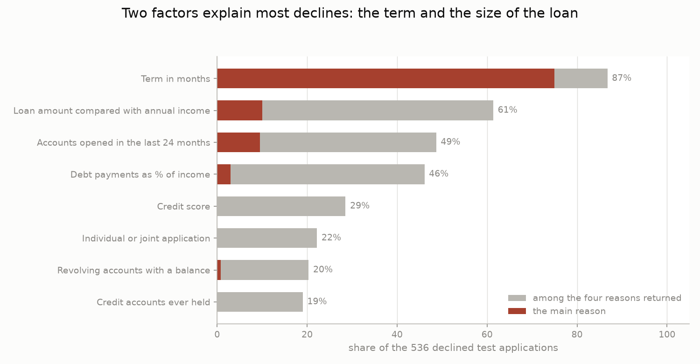
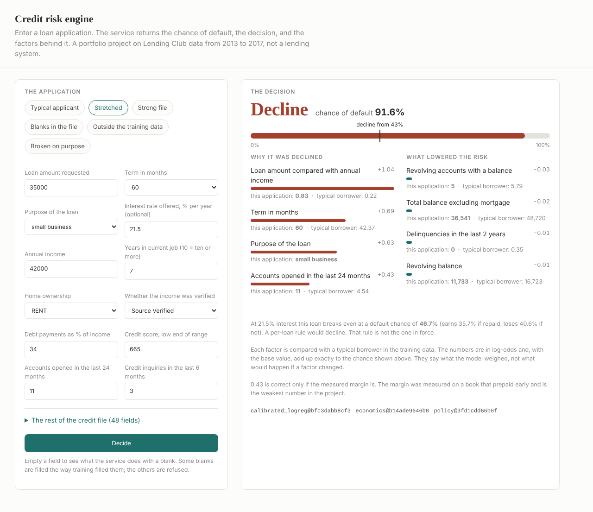

# Slice 9 — deployment

Input: `models/calibrated_logreg.joblib`, `models/economics.json`,
`src/predict.py`, `src/economics.py`, `src/features.py`, and — for checking only
— `model_table.parquet`, `sample_50k.parquet`, `features_train.parquet`,
`features_test.parquet`, `predictions_test_slice6.parquet`,
`shap_logreg_test.parquet`.

Output: a scoring service (`service/`), the one path it calls (`src/decide.py`),
an input contract (`src/contract.py`), a reasons function (`src/reasons.py`),
two new model files (`models/feature_spec.json`, `models/policy.json`), 115
tests, a Dockerfile, a dashboard, two figures, and four findings.

**The model could not be served: the medians, category levels and log choices
of the feature build were never saved, so nothing outside notebook 03 could
turn an application into the 71 features. Switching the guard on changed two
probabilities and not one decision at any threshold the project has ever
considered — the hand-over note said both rows sat near the threshold, and they
do not. "The service reproduces training exactly" turned out to have three
different meanings with three different answers. And at the shipped threshold
three declines in four have the same main reason: the loan runs 60 months.**

> **Where these runs were made.** Everything below was run on a Linux copy of
> the repository, not on the Windows machine that wrote the data files. That
> matters for exactly one thing, described in step 5: two checks that compare
> against the saved feature files come out at 1.8e-15 on Linux and are expected
> to be exactly 0.0 on Windows. Run the commands under *Reproducing* on the
> Windows machine and replace this note with what they print. The Docker image
> was written and its contents were tested in a clean environment with the
> pinned packages, but **the image itself was not built** — the build machine
> could not reach Docker Hub.

## What this slice adds

Slices 1 to 8 produced a model, a proof that its numbers are honest, an
explanation, and a price. All of it lives in notebooks and scripts that read
whole files. This slice asks a narrower question: when one application arrives
on its own, does it get the same number it would have got inside the training
pipeline, and can that be proved rather than assumed?

One rule was added for it, and it shaped every file:

> **The service must not contain a second copy of anything.** If the scoring
> chain, the feature build or the economics appear in both `src/` and the
> service, that is the bug this slice exists to prevent.

## Step 0 — there was nothing to serve

The plan was to wrap `src/predict.py` in an endpoint. `predict_calibrated`
takes the 71 engineered features. An application does not arrive as 71
engineered features; it arrives as an income, a loan amount and a credit file.

Turning one into the other needs three things slice 3 learned from the training
rows:

| learned in slice 3 | where it lived until now |
|---|---|
| 59 medians that fill blanks | a variable in notebook 03, cell 32 |
| the level list of each of 4 categories | a loop variable in cell 33 |
| which columns get a log (decided by their skew) | the return value of `add_logs` |

None of them is in the model bundle, and none was written to disk. The bundle
holds a scaler, a model and a calibrator. So the project had a model whose
inputs could only be produced by re-running a notebook on the full dataset.

`src/features.py` gains three functions — `fit_feature_spec`, `transform`,
`encode_with_levels` — and `add_logs` gains an optional column list, because
one application has no skew. `transform` calls the existing functions in the
existing order; `encode_categories` now calls `encode_with_levels`, so there is
still one implementation of the encoding. `src/feature_spec.py` refits the
learned values on the training rows and writes `models/feature_spec.json`.

Refitting is only safe if it lands on the same numbers, so the same file then
rebuilds every row of both saved feature files through `transform` — the
function the service calls — and compares values:

| file | rows × columns | largest difference |
|---|---|---|
| `features_train.parquet` | 20,902 × 76 | 1.78e-15, in `log_annual_inc` only |
| `features_test.parquet` | 5,378 × 76 | 1.78e-15, in `log_annual_inc` only |

Every other column is identical to the last bit. (The one that is not is step 5.)

Notebook 03 ends with its own rebuild-from-`src/` check. It compares shapes and
sorted column names. A wrong median would have passed it.

## Step 1 — the guard: two probabilities, no decisions

`src/score_test.py` rescores the test set through `src/predict.py` with
`apply_guard=True`, and writes `predictions_test_slice9.parquet` with the
guarded and unguarded columns side by side. It does not go back through
notebook 06, where the logistic chain had been retyped by hand.

It asserts what slice 7 measured, so it fails if the guard is not the small
change slice 7 said it was: exactly 2 of 5,378 rows move, and the largest
probability goes 1.000000 → 0.982307.

| row | loan_to_income | probability | actual outcome |
|---|---|---|---|
| 3240 | 19.500 → 1.782 | 1.000000 → 0.865282 | **repaid** |
| 4012 | 3.788 → 1.782 | 0.999400 → 0.982307 | defaulted |

One confident mistake softened, one correct call slightly dulled.

`src/guard_effect.py` then runs `src/profit.py` twice, on the unguarded and the
guarded probabilities, and compares every number:

| | guard off | guard on |
|---|---|---|
| AUC | 0.690760 | 0.690760 |
| average precision | 0.391850 | 0.392452 |
| Brier | 0.166806 | 0.166760 |
| **log loss** | **0.513118** | **0.507562** |
| largest probability | 1.000000 | 0.982307 |
| threshold chosen on curve A | 0.43 | 0.43 |
| decisions changed at 0.20 | — | 0 of 5,378 |
| decisions changed at 0.43 | — | 0 of 5,378 |
| decisions changed under the per-loan rule | — | 0 of 5,378 |

Those two rows carried 1.16% of the whole test log loss between them, which is
where the log loss improvement comes from.

**The hand-over note was wrong about one thing.** It said both moved rows "sit
near the threshold", which is why `src/profit.py` had to be re-run. They end at
0.865 and 0.982. The highest break-even probability of any loan in the book is
0.575. Neither row is near any threshold under any rule slice 8 examined, and
re-running the whole of slice 8 changed 2 of its 55 table cells, both in the
*approve everyone* row (its predicted profit, by 2,151, and the same number per
euro), and no point of the profit curve below a threshold of 0.87. The sensitivity surface is unchanged and the thin-file gap is unchanged
below 0.87.

So the guard is a calibration fix and not a decision fix. That is the less
exciting result and the true one.

`src/profit.py` now reads the slice 9 file by default.
`main(PREDICTIONS_SLICE6)` still reproduces every number slice 8 first published.

## Step 2 — the threshold: 0.43, shipped with its assumption

Slice 8 left two candidates and said slice 9 had to pick.

| | 0.20 (slice 5) | 0.43 (slice 8) |
|---|---|---|
| approval | 47.9% | 90.0% |
| bad rate among approved | 13.05% | 20.82% |
| predicted profit, curve A | 2,341k | 4,087k |
| profit on true outcomes, curve B | 2,217k | 3,906k |
| thin-file approval gap | −13.4 points | +0.7 points |

**The service ships 0.43.** Three reasons, in order of weight:

1. 0.20 was chosen in slice 5, before the project had any economics. It is a
   round number that looked sensible on a risk-versus-volume plot. 0.43 is the
   only threshold in the project that was derived from something.
2. It was chosen without touching an outcome, and on the outcomes it lands at
   99.89% of the best threshold hindsight could have picked.
3. It is where the fairness gap slice 7 found closes on its own. Shipping 0.20
   would mean shipping a 13-point access gap that buys nothing.

**What is not being claimed.** 0.43 is right only if the measured margin is,
and the margin is the weakest number in the project: it was measured on a book
that prepaid early. Moving the margin alone between 0.6× and 1.4× moves the
best threshold from 0.24 to 0.55. So the threshold is not hard-coded anywhere.
It lives in `models/policy.json`, next to the reasoning, the two rejected
alternatives, and the sensitivity range; every response carries
`threshold_assumption`; and `GET /version` returns the whole file.

**The per-loan rule is not shipped.** It is the optimum of curve A and lost 68k
to the global threshold on true outcomes. Slice 8 attached a prediction —
improve tail calibration and the order should flip. The guard improved tail
calibration slightly, so the prediction was re-tested: the per-loan rule's
decisions did not change on a single loan, and neither did the 68k. Not enough
calibration moved to test it. If the caller sends `int_rate`, the response
reports what the per-loan rule would have said, labelled as not in force.

## Step 3 — the input contract

Written before the code, in `docs/slice_09_input_contract.md`. The short form:

| situation | answer | why |
|---|---|---|
| blank, in one of the 10 columns training had blanks in | impute as training did, flag | the model was fitted on rows treated exactly this way |
| blank, anywhere else | reject | any fill would be invented by the service |
| impossible value (negative income, score of 900, term of 48) | reject | scoring an error gives a confident number about nothing |
| possible, but outside what the model saw | score, flag, recommend review | the range is one lender's policy, not a boundary of the world |
| `loan_to_income` above the training maximum | clip, flag | the one clip that was measured |
| category the model never saw | reject | pandas would silently score it as the base level |
| rare category that training folded | fold, flag | same treatment as training |
| field name the contract does not know | reject | a typo would otherwise become a silent imputation |

All of it follows from one sentence: *the service may do to an application only
what training did to a training row, and nothing is done silently.*

## Step 4 — one path

`src/decide.py` is the whole route from an application to a decision, and every
step in it is another file's function:

```
validate()            src/contract.py     reject / impute-and-flag / score-and-flag
transform()           src/features.py     the slice 3 build, replayed
predict_calibrated()  src/predict.py      the slice 5 chain, guard on
price_loans()         src/economics.py    the slice 8 break-even
explain()             src/reasons.py      the slice 7 contributions
```

`service/app.py` is 119 lines and turns HTTP into a call to that file.

| endpoint | returns |
|---|---|
| `POST /decision` | the decision, the probability, the threshold, the versions, the flags |
| `POST /reasons` | the same, plus the factors that raised and lowered the risk |
| `GET /version` | the model, the policy file, and what the threshold assumes |
| `GET /contract` | every field, what it accepts, what happens to a blank |
| `GET /example` | a made-up typical applicant |
| `GET /health` | `ok` and the four version strings |
| `GET /` | the dashboard |

**Versions are hashes.** `model_version` is `calibrated_logreg@` plus the first
12 characters of the SHA-256 of the bundle file, and the same for the feature
spec, the economics and the policy. A date or a hand-typed version number can
be forgotten when a file changes. A hash cannot.

**The rule has a test.** `test_the_service_holds_no_copy_of_the_pipeline` reads
the source of `service/` and fails if it finds `decision_function`,
`predict_proba`, `fillna`, `get_dummies`, `log1p`, `clip(`, `coef_`,
`margin_pct` or `p_star`, and fails if the dashboard contains the threshold as
a literal. It is a blunt test. It is also the only one that would have caught
notebook 06 retyping the chain.

`src/predict.py` changed in one way: the select-guard-scale step is now its own
function, `scale_features`, which `predict_calibrated` calls. The reasons need
the scaled values and must not scale anything their own way.

## Step 5 — the skew test, and what "exactly" means

`tests/test_skew.py` takes the raw rows from before any feature engineering,
turns each into the JSON a caller would send, pushes it through the service,
and compares what comes out with what the training pipeline saved.

| check | result |
|---|---|
| test applications rejected by the contract | 0 of 5,378 |
| 71 features, raw row → service, vs `features_test.parquet` | 70 columns identical, 1 at 1.78e-15 |
| 71 features, raw row → service, vs `features_train.parquet` | 70 columns identical, 1 at 1.78e-15 |
| probability, raw row → service, vs the published file | **0.0** |
| probability, raw row → service, vs `src/predict.py` on the saved features | **0.0** |
| decisions vs the published probabilities at 0.43 | 5,378 of 5,378, 4,842 approved |
| rows the guard touches | the same 2 slice 7 measured |
| one request over HTTP vs the same call made directly | **identical, whole response** |

The plan said "assert it reproduces the published probabilities exactly". Doing
it showed that sentence has three meanings.

**1. The same rows, as a batch, on the machine that wrote the files: exact.**
This is the claim that matters, and it holds at 0.0.

**2. The same code on a different machine: not exact.** The feature rebuild
differs from the saved files in one column, `log_annual_inc`, by 1.78e-15, and
`python -m src.predict` differs from slice 6's file by 2.22e-16. Same code, same
numpy and scikit-learn versions. The maths library underneath rounds the last
bit of `log1p` and of the matrix multiply differently on Windows and on Linux.
The Docker image is Linux, so this is not hypothetical.

It happens to be harmless twice over: `log_annual_inc` has a weight of exactly
zero, and 2.2e-16 is a trillion times smaller than the 2.8e-4 by which the
closest test probability misses the threshold. But "harmless" was measured, not
assumed.

**3. One row on its own against the same row in a batch: not exact either.**
This one needs no second machine. Scoring each of the 5,378 test applications
alone, and comparing with scoring them together, gives a largest difference of
3.3e-16, with 1,481 rows (27.5%) not bit-identical. The matrix multiply adds 71
numbers in a different order for one row than for many. The service scores one
application at a time; every published number in this project was scored as a
batch.

So the tolerance is a setting with a default of exact (`src/tolerance.py`):
unset on the machine that built the files, `CRE_FLOAT_TOL=1e-12` anywhere else,
and a fixed `1e-12` for one-row-against-batch. 1e-12 is thousands of times the
measured difference; a wrong median or a reordered column shows up at 1e-3 or
more and still fails.

JSON, which was the suspect going in, is innocent: a response over HTTP is
equal to the same call made directly, field for field.

## Step 6 — reasons

`POST /reasons` returns the decision plus the four factors that raised this
applicant's risk the most and the four that lowered it, each with the
applicant's value and the typical training borrower's.

The method is slice 7's: for a linear model on scaled features, with the
training rows as the reference, a feature's contribution is its coefficient
times its scaled value, and it is arithmetic, not an estimate. `src/reasons.py`
reproduces slice 7's saved contributions for all 5,378 × 71 values with a
difference of 0.0.

Two things are new.

**The contributions are carried through the calibrator.** Slice 7 explained the
raw score. The service returns the calibrated probability. If the reasons
described one and the response reported the other, they would not add up. So
each contribution is multiplied by the calibrator's slope (0.9475) and the base
value takes its shift (0.2898). The base plus the contributions is then the
log-odds of the exact probability in the same response — asserted to 1e-12 in
the self-check and on every sampled request in the tests.

**71 features become 59 factors.** The seven purpose dummies are one fact about
an applicant. So are a balance and its log, and a recency and its
"was blank" flag. Contributions inside a group are added, which is exact
because the whole explanation is a sum.

What the declines are made of, over the 536 declined test applications:



| factor | the main reason | among the four returned |
|---|---|---|
| term in months | **75.0%** | 86.8% |
| loan amount compared with income | 10.1% | 61.4% |
| accounts opened in the last 24 months | 9.5% | 48.7% |
| debt payments as % of income | 3.0% | 46.1% |

At 0.43 the service declines one application in ten, and three of every four
declines are led by the same fact: the loan runs 60 months. That is not a bug in
the reasons. `term` has the largest weight in the model by a factor of two, and in the
training rows 60-month loans defaulted at 32.9% against 13.9% for 36-month
ones. But it
means the shipped policy is close to "60-month loans need something else going
for them", and a reason like that is only useful to an applicant if somebody
tells them a 36-month loan would be scored differently. The endpoint says what
the model weighed. It does not yet say what would change the answer.

**What this endpoint is and is not.** The EU AI Act lists AI systems that
evaluate the creditworthiness of people among its high-risk uses, and its
Article 86 gives a person affected by a decision based on such a system a right
to an explanation of the role the system played and the main elements of the
decision. This endpoint is the raw material for an explanation of that kind. It
is not a compliance claim: this is a portfolio project on public data, and what
the regulation requires of a real lender is a question for a lawyer.

## Step 7 — Docker

`Dockerfile` builds from `python:3.13-slim`, installs `requirements-service.txt`
(eight packages — the development `requirements.txt` has 144, one of them
Windows-only), and copies `src/`, `service/`, `tests/` and four named files
from `models/`. No data goes in: the service never reads `data/`.

The image runs its own tests while it is built. The 105 contract and service
tests need only `models/` and run; the 10 skew tests need the processed data,
find it missing, and skip with that reason. A build that finishes has loaded the
model, built features and answered requests on that exact image.

**Not verified:** the build itself. In place of it, the same eight packages at
the same pins were installed into an empty environment containing only the
files the Dockerfile copies: 105 passed, 10 skipped, and the service started and
answered. That tests everything in the image except Docker.

## Step 8 — the dashboard



One HTML file, no build step, no framework, served at `/`. It holds no model,
no threshold and no field list: `GET /contract` draws the form, `GET /example`
fills it, `POST /reasons` decides. Six buttons load a typical applicant, a
stretched one, a strong one, one with blanks, one outside the training data and
one broken on purpose — the last three exist to show the contract working, which
is the part of this slice a 30-second demo would otherwise never reach.

## What the contract did to the test book

`src/service_report.py`, reporting only.

| | applications | share |
|---|---|---|
| rejected | 0 | 0.00% |
| a blank was imputed | 1,207 | 22.44% |
| a rare category was folded | 139 | 2.58% |
| a value outside the training range | 156 | 2.90% |
| `loan_to_income` guard applied | 2 | 0.04% |
| review recommended | 157 | 2.92% |

117 of the 156 are loans above 35,000, the largest in the training rows; the
test window goes to 40,000. The lender's maximum moved after training ended, and
the contract flagged every one of those applications without knowing why. The
157 flagged applications were approved less often (79.6% against 90.3%) and
defaulted no more often (21.0% against 23.7%). On 157 rows that difference is
not evidence of anything, and it is written down so nobody later reads the flag
as a risk signal. It is a "the model is guessing" signal.

## Limitations

- **Only funded loans exist.** Everything here is inside the population Lending
  Club already approved. The service will score an applicant Lending Club would
  have refused, flag what is outside the training range, and still be
  extrapolating.
- **The reasons are not advice.** A contribution says what the model weighed
  against a typical borrower. It does not say that changing the factor would
  change the outcome, and for a correlational model on observational data it
  cannot.
- **17 required fields cannot change any answer.** 24 of the 71 features have a
  weight of zero. The fields stay required because the saved scaler works on all
  71 columns by position.
- **No authentication, no rate limit, no request log.** It is a demonstration
  service. A request log is the first thing slice 10 needs.
- **The model is dated.** Trained on 2013–2015. Nothing in a response can say
  how far the world has moved.

## Rules kept

| rule | how |
|---|---|
| no decision made on test | the threshold was chosen in slice 8 on curve A; this slice read it from a file. The guard run reports the threshold it produces next to the published one and tunes nothing |
| anything found on test is documented, not fixed | the 117 loans above the training maximum, the 75% of declines led by term, the flagged group's default rate |
| rows in `issue_d` order before time-based work | asserted in `feature_spec.py`, `service_report.py`, `profit.py` and the first skew test |
| learned numbers come from train only | medians, levels and log columns from the rows before 2016-09 (slice 3's choice, kept); ranges and the typical applicant from the rows before 2016-01 |
| no second copy of anything | `src/decide.py` computes nothing; `service/` is tested for it |

The test set has now been used six times, every time for reporting.

## Known debt carried into slice 10

- **Run this slice on the Windows machine** and replace the note at the top.
  Build the Docker image.
- The bundle key `loan_to_income_guard_not_applied` is now misnamed, and the
  bundle's stored `test_log_loss` of 0.5131 is the unguarded figure. The bundle
  was not rewritten: its hash is the model version, and nothing about the model
  changed. Rename the key the next time the model is retrained.
- **Monitoring has four things to count from day one**, and this slice built the
  counters: the share of requests with `outside_training_range`, by field
  (`loan_amnt` first); the share rejected, by reason; the share imputed, by
  field; and the main decline reason. A jump in any of them is drift arriving
  before a single outcome is known.
- The margin is still the weakest number. Slice 10 should watch realised margin
  per vintage, not just score drift.
- The per-loan rule is still unshipped and its prediction is still untested.
- The reasons say what was weighed, not what would change the answer.
  Counterfactual reasons ("at 36 months this would be approved") are the honest
  next step and are easy for a linear model.
- Slice 7's interaction values still use a path-dependent reference, and its
  Texas and Florida contrasts are still exploratory. Untouched.

## Reproducing

```
pip install -r requirements-service.txt   # adds fastapi, uvicorn, pytest, httpx

python -m src.score_test       # guard on; writes predictions_test_slice9.parquet
python -m src.feature_spec     # writes models/feature_spec.json, proves the rebuild
python -m src.guard_effect     # what the guard changed downstream
python -m src.profit           # slice 8 again, on the guarded probabilities
python -m src.reasons          # the reasons are slice 7's and add up
python -m src.service_report   # the service on the whole test book, one figure
python -m pytest tests -q      # 115 tests

uvicorn service.app:app --port 8000        # then open http://localhost:8000

docker build -t credit-risk-engine .
docker run --rm -p 8000:8000 credit-risk-engine
```

Run `src.score_test` first: the tests compare against the file it writes, and
that file should be written by the machine that runs the tests.

On any machine other than the one that built `data/processed`, set
`CRE_FLOAT_TOL=1e-12` first (PowerShell: `$env:CRE_FLOAT_TOL = "1e-12"`).
`src/tolerance.py` says why.
