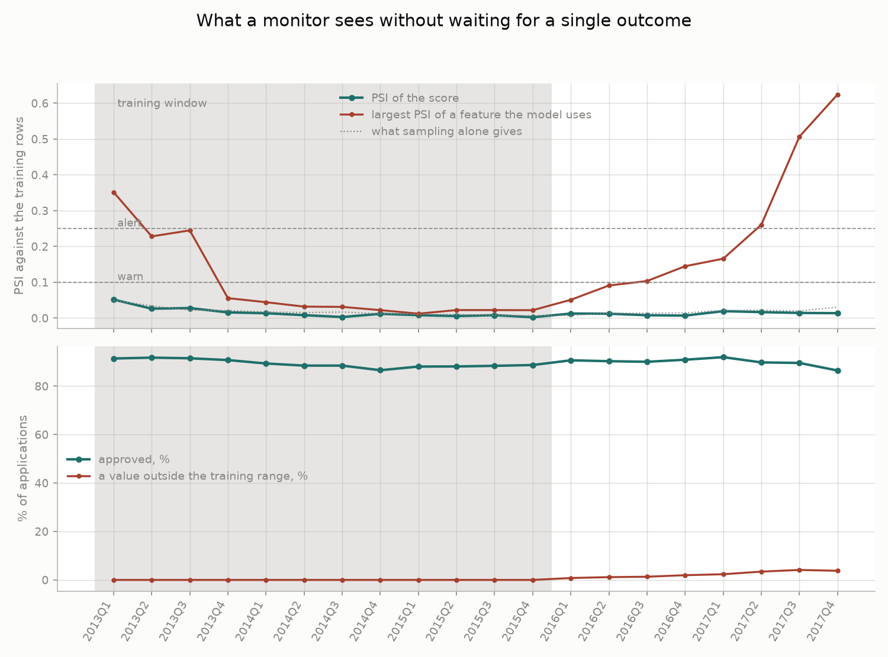
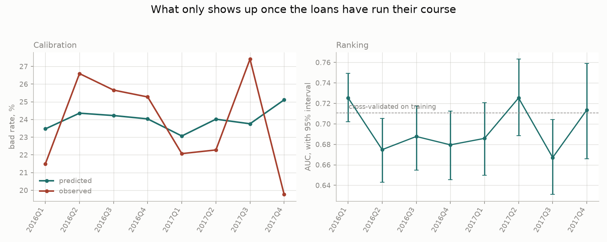

# Slice 10 — monitoring

Input: the service from slice 9 (`src/decide.py`, `models/`), and — for the
replay only — `model_table.parquet`, `sample_50k.parquet`,
`features_train.parquet`, `features_test.parquet`, `money_table.parquet`.

Output: a request log (`src/requestlog.py`), a monitor (`src/monitor.py`), a
retraining script (`src/retrain.py`), a declared alert policy
(`models/monitor_policy.json`), 12 more tests (127 in all), a CI workflow,
two figures, and four findings.

**The one-number alarm never rang. Across eight quarters after training the
PSI of the score stayed below 0.02 and the approval rate barely moved — while
joint applications went from 10 of 16,134 training loans to about one application in
nine, were scored 11 points too high, and were declined four and a half times
as often as everyone else. The per-feature PSI caught it; the summary did not.
Outcomes arrive too late and too biased to monitor on: six months after a
quarter ends, the bad rate a monitor can see is 7.5% against 23.8% in the end.
And retraining on what was really known on the day would have made the model
worse, not better.**

> **Where these runs were made.** On a Linux copy of the repository holding
> the same data files, not on the Windows machine. Run the commands under
> *Reproducing* there. The CI workflow is written and its steps were run by
> hand in a clean environment, but it has not run on GitHub yet: that needs a
> push.

## What this slice adds

Slice 9 put the model behind an API. This slice asks what happens the day
after. A model does not fail with an error. The applicants change, the lender
changes its products, and the same code keeps returning confident numbers
about people it never saw.

There is no live traffic to watch, so the slice replays history. The model was
fitted on applications before 2016-01. Every application from 2013 to 2017 is
pushed through the service's own path with its application date as the
timestamp, and the eight quarters of 2016 and 2017 are read as production.

The rule from slice 9 still holds: nothing is computed twice. The monitor
rebuilds features from the logged application through `src/decide.py`, and the
replay writes the same records the service writes.

## Step 0 — the policy was written first

`models/monitor_policy.json` says what counts as a warning and as an alert. It
was written before the monitor was run on anything.

| measure | warn | alert | needs outcomes? |
|---|---|---|---|
| PSI of a feature or of the score | 0.10 | 0.25 | no |
| share of requests outside the training range | 1% | 5% | no |
| share of requests rejected | 1% | 5% | no |
| calibration gap (predicted − observed) | 3 points | 5 points | yes |
| AUC | 95% interval entirely below 0.7107 | — | yes |

0.10 and 0.25 are the usual rule of thumb and are not tuned to this data. One
rule is added to them: **a PSI only counts if it is above what sampling alone
gives.** A window of 800 applications has a PSI above zero against the training
rows even if nothing changed. The monitor draws 200 random samples of the same
size from the training rows and uses their 99th percentile as the floor.

One honesty note is in the file itself: the two "share of requests" thresholds
were written after slice 9 had already reported 2.9% outside the range, so
they are not blind. They are round numbers on purpose.

A retrain review is triggered by two quarters in a row with an alert on the
score PSI or on calibration. A review is a person looking, not an automatic
retrain. Step 5 is why.

## Step 1 — the request log

Slice 9 ended with "no request log; it is the first thing slice 10 needs".
`src/requestlog.py` appends one JSON line per decision: the application as it
arrived, the decision, the probability, the flags, the versions, and the names
of the factors that raised the risk. Rejected applications are logged with
their reasons.

- It is **off** unless `CRE_REQUEST_LOG` names a file, because the log holds
  incomes and credit files. In real use it is personal data.
- A failed write does not fail the request. It prints one warning, because a
  silent gap in the log is its own monitoring failure.
- When the log is on, the reasons are worked out for every request so the
  monitor can count what declines are made of. The caller of `/decision` still
  gets the same response as before, and a test checks that.

`python -m src.monitor LOGFILE` reads a real log. Below 300 scored requests it
prints the counters only and says a PSI would not mean anything yet.

## Step 2 — what a monitor sees without waiting for an outcome



| quarter | n | approved | outside range | score PSI (noise floor) | features in warn / alert |
|---|---|---|---|---|---|
| 2016Q1 | 2,405 | 90.7% | 0.8% | 0.013 (0.007) | 0 / 0 |
| 2016Q2 | 1,395 | 90.3% | 1.1% | 0.012 (0.014) | 0 / 0 |
| 2016Q3 | 1,360 | 90.1% | 1.3% | 0.008 (0.014) | 2 / 0 |
| 2016Q4 | 1,278 | 90.9% | 2.0% | 0.007 (0.015) | 1 / 0 |
| 2017Q1 | 1,024 | 92.0% | 2.3% | 0.019 (0.022) | 2 / 0 |
| 2017Q2 | 992 | 89.8% | 3.4% | 0.017 (0.022) | 4 / 1 |
| 2017Q3 | 923 | 89.6% | 4.1% | 0.014 (0.020) | 6 / 1 |
| 2017Q4 | 769 | 86.5% | 3.8% | 0.014 (0.031) | 10 / 1 |

**The score PSI never reaches a fifth of the warning level.** In seven of the
eight quarters it is inside what sampling alone gives. Approval stays between
86.5% and 92.0%. A dashboard showing only these two lines would have been
green for two years.

Underneath, the inputs were moving. By 2017Q4 ten of the 71 features are in
warning and one is in alert:

| feature | PSI | weight in the model |
|---|---|---|
| `application_type_Joint App` | **0.625** | +0.007 |
| `bc_util` | 0.234 | 0 (the model ignores it) |
| `percent_bc_gt_75` | 0.229 | +0.030 |
| `revol_util` | 0.216 | +0.067 |
| `num_rev_tl_bal_gt_0` | 0.140 | +0.120 |

Two different things are in that table. The card-utilisation features drift
slowly and steadily: the median `revol_util` falls from 64.5 in 2013Q1 to 42.1
in 2017Q4, and it was already falling inside the training window. The joint
flag is a different kind of change: a new product.

**Why the score did not move.** The model is linear, so the shift in the
average log-odds is exactly the sum over factors of weight × shift in that
factor. By 2017Q4 the total is +0.010, made of pieces that cancel: credit score
−0.059, revolving balance +0.039, revolving accounts with a balance −0.033,
joint applications +0.031, accounts opened in 24 months +0.031. A stable
average is not the same as nothing changing.

**The counter slice 9 built did its job.** The share of applications with a
value outside the training range climbs from 0.8% to about 4%, in warning for
seven of eight quarters. `loan_amnt` is the field in every quarter: the largest
loan goes from 35,000 to 40,000 in 2016Q1, the first quarter after training.

## Step 3 — the alert, followed up: joint applications

| | live applications | predicted | observed | declined |
|---|---|---|---|---|
| individual | 9,760 | 23.3% | 23.6% (± 0.8) | 8.6% |
| **joint** | **386** | **39.4%** | **28.0% (± 4.5)** | **38.9%** |

In the training rows 10 of 16,134 applications were joint. By 2017Q4 it is
11.7%. The model predicts 39.4% default for them and 28.0% happened. They are
declined four and a half times as often as individual applications.

Two causes, of about the same size.

1. **The weight was learned from 10 loans.** Five of them defaulted. And a
   flag that is set on 0.06% of rows has a standard deviation of 0.025, so the
   scaler turns a 1 into a value 40 standard deviations out. The small weight
   becomes +0.27 log-odds on every joint application.
2. **The model scores a two-income application on one income.** For a joint
   application the raw data has `annual_inc_joint` and `dti_joint`, and slice 2
   and 3 never used them. The model sees a median income of 50,000 and a debt
   ratio of 25.3. The lender underwrote on a median joint income of 103,850 and
   a joint ratio of 19.0. This is the likely reason for what the flag does not
   explain; it was not tested, because testing it means building a new feature.

The hindsight challenger in step 5 gives the rough split. On its 238 joint
loans the shipped model predicts 39.9%. With the flag's weight at zero the
challenger predicts 35.7%. 31.9% happened. About half the gap goes with the
flag and half stays.

**Not fixed.** This was found by reading 2016–2017, most of which is the test
set. The rule is that anything found there is written down, not repaired. The
repair is also a feature decision, not a monitoring one: use the joint income
when there is one. It is the first item of known debt below.

## Step 4 — outcomes: late, and wrong when they are early



Once outcomes are known, the model holds up. The calibration gap is inside 2.2
points in six of eight quarters, and the AUC interval covers the training
figure of 0.7107 in six of eight. 2017Q3 is in warning on both (gap −3.7
points, AUC 0.667). 2017Q4 raises the one calibration alert: 25.1% predicted
against 19.8% observed.

That alert should not be trusted, and the reason is the main point of this
step. **An outcome is only "known" when the loan has finished**, and the loans
that finish first are not a fair sample.

| months after the quarter ended | outcomes known | bad rate a monitor sees | in the end |
|---|---|---|---|
| 6 | 21.5% | 7.5% | 23.8% |
| 12 | 46.3% | 17.5% | 23.8% |
| 18 | 72.8% | 22.8% | 23.8% |
| 24 | 87.1% | 24.1% | 23.8% |

A loan that is repaid early is known the month it is repaid. A default is only
booked about five months after the last payment. So early on, a monitor sees
mostly the fast repayers and concludes the book is three times safer than it
is. It takes about 18 months for the number to be usable.

And "in the end" is itself only the loans that had finished by the snapshot.
Of the 2017Q4 applications in the 50,000-row sample, 769 had resolved and
1,811 were still running. The 19.8% that set off the alert is measured on the
769.

**The same thing explains the margin.** Slice 8 called the margin the weakest
number in the project and asked this slice to watch it per vintage.

| quarter | margin predicted | realised | ratio | months to repay |
|---|---|---|---|---|
| 2013Q4 | 20.1% | 22.3% | 1.11 | 29.0 |
| 2015Q4 | 16.3% | 15.2% | 0.94 | 24.8 |
| 2016Q4 | 18.8% | 12.4% | 0.66 | 14.2 |
| 2017Q4 | 19.1% | 8.1% | 0.42 | 8.4 |

The realised margin falls to 42% of the prediction. But the repaid loans of
2017Q4 ran 8.4 months on average, because only a loan that repaid that fast is
in the data. A loan that pays interest for 8 months earns less than one that
pays for 29. This table cannot separate "borrowers prepay sooner now" from
"only the early prepayers are visible yet", and the honest reading is that it
is mostly the second. Watching the margin properly means comparing vintages at
the same age, which needs monthly payment records this dataset does not have.

So the declared policy, applied to the replay:

| | warn | alert |
|---|---|---|
| score PSI | 0 of 8 quarters | 0 |
| outside the training range | 7 | 0 |
| calibration (needs outcomes) | 1 | 1 |
| AUC (needs outcomes) | 2 | — |
| **retrain review** | **never triggered** | |

## Step 5 — retraining

`src/retrain.py` answers two questions.

**Can the shipped model be rebuilt at all?** The fit lived in notebook 05.
`fit_bundle()` is that recipe as one function. Refitted on the original rows it
gives the shipped model back: the same 47 features, weights within 1.7e-15,
calibrator within 7.8e-16, every test probability within 2.0e-15. Until now
that had been assumed.

**Would retraining have helped?** Stand on 2017-04-01, retrain, and score the
2,684 loans of the nine months that follow. The recipe and `C` are the shipped
ones; nothing is re-tuned. "Retrain with what was there" has two meanings:

| | trained on | AUC | against shipped, 95% interval | predicted | observed |
|---|---|---|---|---|---|
| shipped | before 2016-01 | 0.6970 | | 24.2% | 23.3% |
| retrained, as it happened | 10,741 loans whose outcome was known that day | 0.6958 | −0.0012 [−0.0066, +0.0046] | **15.6%** | 23.3% |
| retrained, with hindsight | all 23,596 loans issued before, final outcomes | 0.6974 | +0.0004 [−0.0024, +0.0034] | 25.0% | 23.3% |

- **With hindsight, retraining buys nothing.** About 2,700 more loans and
  seven more months, and the ranking is the same to the third decimal. That
  agrees with slice 6: the usable signal in this data is small and stable.
- **As it really would have happened, retraining breaks the calibration.** Of
  the 7,462 loans issued since 2016-01, only 19% had a known outcome on the
  day, and their bad rate was 13.4% against 23.9% in the end. The calibrator
  learns from those rows that defaults are rare and predicts 15.6% for a book
  that defaulted at 23.3%. At the 0.43 threshold it approves 98.3% of them,
  against 88.8% for the shipped model.

This is why the policy says a review is a person looking. A scheduled job that
retrains on "all labelled data so far" would have replaced a calibrated model
with a miscalibrated one and reported success.

For joint applications in those nine months (238 loans, 31.9% observed): the
shipped model predicts 39.9%, the hindsight model 35.7% with the flag's weight
at zero, the as-it-happened model 23.0% — right for the wrong reason, since it
under-predicts everyone.

**Neither challenger is shipped or could be.** Both were fitted on rows from
the test period and scored on the rest of it. Promoting one on this evidence
would be choosing on test. `models/` is not touched.

## Step 6 — CI

`.github/workflows/ci.yml` runs on every push: install the eight service
packages, run the tests, build the Docker image (which runs the tests again
inside it), start the container and ask it for a decision.

What it cannot check is the skew test and the replay. They compare against
`data/processed`, which is gitignored. Those 11 tests skip and print why; the
other 116 run. The skew test stays a test for the machine that has the data.

Writing the workflow found one bug before it shipped: the new policy file was
not in the Dockerfile's copy list, so the image build would have failed at its
own test step.

## Step 7 — no public link, on purpose

A hosted demo was considered and left out. Anyone with Docker can run the
service from the repository with four commands, and the README shows the
dashboard, so a hosted copy would add a service to keep alive for little gain.

One change made for it was kept because it costs nothing: the Dockerfile reads
the port from `PORT` and falls back to 8000. Most hosts set that variable, so
hosting it later needs no change to the image.

## Limitations

- **The replay only holds loans that had finished by the snapshot.** About
  half of the 2016–2017 applications in the sample were still running and are
  not in it. A live monitor would see every application, so the input drift
  measured here is of a subset, and it is the subset that resolved early.
- **Quarterly windows are small.** 769 to 2,405 applications. The noise floor
  handles the PSI; the AUC intervals are ± 0.03 to 0.05.
- **One retrain date.** The walk-forward test stands on a single day. A
  different day would give different numbers; the label-delay effect would not
  go away.
- **The five-month charge-off lag is an assumption** about when a default
  becomes known. It moves the maturity table by a few points, not its shape.
- **No alert goes anywhere.** The monitor prints and writes tables. Sending a
  message when a level changes is a deployment detail left out on purpose.

## Rules kept

| rule | how |
|---|---|
| no decision made on test | the policy was written before the run; an alert changes nothing in `models/`; no challenger is shipped |
| anything found on test is documented, not fixed | joint applications, the 2017Q4 calibration alert, the falling margin |
| rows in `issue_d` order before time-based work | asserted in `monitor.py` and `retrain.py` |
| learned numbers come from train only | the PSI bins, the noise floor and the reference are the 16,134 training rows |
| no second copy of anything | the monitor rebuilds features through `src/decide.py`; the replay writes the service's own log records |

The test set has now been used seven times, every time for reporting.

## Known debt

- **Joint applications are scored on one income.** Use `annual_inc_joint` and
  `dti_joint` where they exist, refit, and judge it on data this project has
  not yet looked at.
- **A flag set on 10 training rows should not carry a weight.** A minimum
  count for a category, like the rare-level fold slice 3 already does for
  `purpose`, would have folded it away.
- The margin needs vintage-at-the-same-age monitoring, and data that allows it.
- The bundle key `loan_to_income_guard_not_applied` is still misnamed.
- The per-loan rule from slice 8 is still unshipped and its prediction still
  untested.

## Reproducing

```
python -m src.monitor      # the replay: tables in data/processed, two figures
python -m src.retrain      # rebuilds the shipped model, then the walk-forward test
python -m pytest tests -q  # 127 tests

# with the request log on
$env:CRE_REQUEST_LOG = "data/requests.jsonl"
uvicorn service.app:app --port 8000
python -m src.monitor data/requests.jsonl
```
